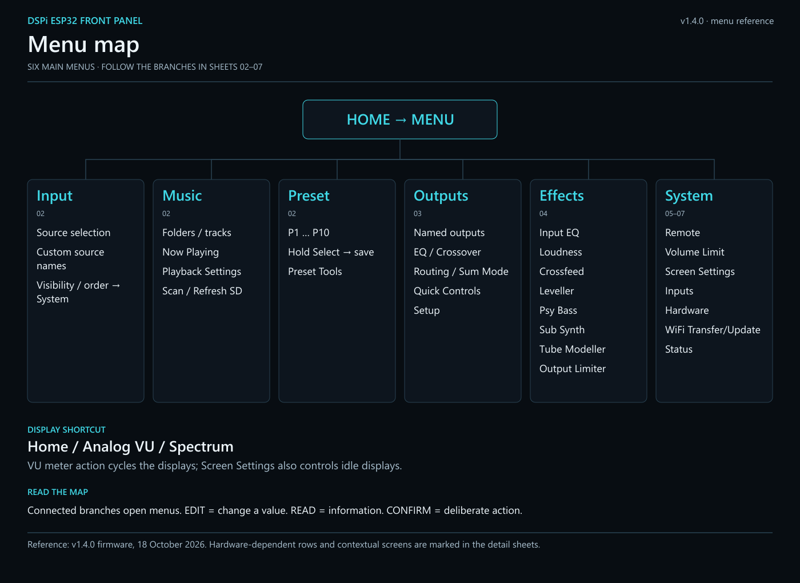

# DSPi ESP32 Front Panel — Media Player S/PDIF

ESP32-S3 front-panel firmware with integrated SD-card and SMB network music playback and a single-wire, 24-bit, 44.1/48 kHz logic-level S/PDIF connection to a WeebLabs DSPi.

> [!IMPORTANT]
> The ESP32-to-DSPi audio link is direct 3.3 V GPIO-level S/PDIF. It is not a consumer coaxial or optical connection. Read [S/PDIF implementation and wiring](SPDIF-IMPLEMENTATION.md) before connecting the hardware.

The front-panel interface, presets, BLE remote support, analogue VU, stereo Spectrum and local Wi-Fi transfer/update portal remain included.

## Version 1.5.0

### New since v1.4.0

- **Network music:** browse Windows or NAS SMB shares as folders and play WAV, FLAC and MP3 through the existing S/PDIF output. Includes album artwork, scrolling filenames, track controls and the same Now Playing layout as the SD player.
- **DSPi Link:** connect compatible DSPi Console applications over the local network through the panel's UART bridge. The encoder, BLE remote and panel controls remain available while Link is active.
- **Wi-Fi setup:** QR-guided phone setup, a network picker, shared connection settings, a connected-only signal page and a Wi-Fi indicator. Network playback tries the strongest matching access point first.
- **Retro theme:** seven-segment volume, pixel-style text, dimmed inactive segments and separate Retro volume colour.
- **Volume display and control:** choose User Volume or Master Volume under **System > Screen Settings > Volume display**. The home display, encoder and learned volume controls follow the selected mode.
- **DSPi source names:** compatible DSPi v1.1.6 firmware shares physical-input names with Console and the panel. Input visibility and order remain panel settings.
- **Preset navigation:** an explicit Back entry below Preset Tools for encoder-only operation.
- **DSPi v1.1.6 integration:** supports the current control-interface version 22 alongside capability-based access to output, EQ and hardware controls.

User Volume represents listening level and drives loudness compensation. Master Volume provides overall attenuation without changing that User level.

Output routing, precise EQ/crossover editors, Copy Parameters, mono summing, speaker/subwoofer Quick Controls and Preset Tools remain included. Input EQ is under **Effects**; output EQ/crossover is under **Outputs > channel**.

[Download v1.5.0](https://github.com/CrawlingKingSn8ke/DSPi-ESP32-Front-Panel-Media-Player-SPDIF/releases/tag/v1.5.0) · [Release notes](RELEASE-NOTES-v1.5.0.md)

The release includes `DSPi-ESP32-Front-Panel-v1.5.0-OTA.bin`, `DSPi-ESP32-Front-Panel-v1.5.0-Full.bin`, source and SHA-256 checksums. Earlier releases remain available for rollback.

## Menu map

The graphical sheets document the original Outputs/EQ layout. The additional v1.5.0 paths are listed below and in the release notes.



[Complete scalable map](docs/menu-map/00-complete-menu-map.svg) · [Full-size PNG](docs/menu-map/00-complete-menu-map.png) · [Detailed sheets](docs/menu-map/README.md) · [Text reference](docs/menu-map/MENU-REFERENCE.md)

## Hardware

- Waveshare ESP32-S3-LCD-2, 320 x 240.
- Raspberry Pi Pico or Pico 2 running compatible DSPi firmware.
- Mechanical rotary encoder with push switch.
- Optional BLE HID remote.
- microSD card formatted as FAT32 or exFAT.

## DSPi compatibility

- DSPi firmware v1.1.5/V28 and compatible v1.1.6 builds: four S/PDIF inputs and verified runtime notifications are supported.
- Sub Synth requires compatible DSPi v1.1.6-beta3 or newer firmware with the extended control commands.
- Tube Modeller, Output Limiter and Spectrum require compatible DSPi v1.1.6 firmware exposing their commands and telemetry.
- Earlier compatible DSPi firmware: the fourth S/PDIF source remains hidden when only three inputs are reported.

## Wiring

### ESP32 to DSPi UART

| ESP32-S3-LCD-2 | DSPi Pico 2 | Function |
|---|---|---|
| GPIO16 | GPIO16 | ESP32 RX from DSPi TX |
| GPIO17 | GPIO17 | ESP32 TX to DSPi RX |
| GND | GND | Common ground |

The UART runs at 115200 baud. Enable the DSPi UART interface with TX GPIO16 and RX GPIO17.

### ESP32 music-player S/PDIF to DSPi

| ESP32-S3-LCD-2 | DSPi Pico / Pico 2 | Function |
|---|---|---|
| GPIO13 | GPIO5 | Logic-level S/PDIF data to DSPi S/PDIF input 1 |
| GND | GND | Common ground |

Configure DSPi S/PDIF input 1 on Pico GPIO5. The firmware validates this setting before starting playback. Keep the direct 3.3 V logic connection and common-ground return short; no coaxial or optical line driver is implied. Do not connect this GPIO-level signal to consumer coaxial S/PDIF equipment.

### Rotary encoder

| Encoder | ESP32-S3-LCD-2 |
|---|---|
| CLK / A | GPIO47 |
| DT / B | GPIO48 |
| Push switch | GPIO21 |
| Common / switch return | GND |

Power encoder modules from 3.3 V, not 5 V.

## Flash on Windows

1. Download the latest v1.5.0 release source or clone `main`.
2. Install Python 3 if `py --version` does not show a version.
3. Connect the ESP32-S3-LCD-2 by USB.
4. Close Arduino Serial Monitor and any program using the COM port.
5. Open PowerShell in the project folder and run:

```powershell
powershell.exe -NoProfile -ExecutionPolicy Bypass -File ".\Flash-DSPi-Front-Panel-v1.5.0.ps1"
```

Supply the correct serial port with `-Port COM7` (replace COM7 with your port). Without `-Port`, the script uses COM10. It installs the required build tools when needed, compiles the firmware and performs a clean flash.

To update only the application while preserving BLE pairing and panel settings:

```powershell
powershell.exe -NoProfile -ExecutionPolicy Bypass -File ".\Flash-DSPi-Front-Panel-v1.5.0.ps1" -PreserveSettings
```

A clean flash erases BLE pairing, learned key mappings, brightness, screen-power settings and shortcut assignments. After a clean flash, disconnect all power for at least 10 seconds before reconnecting.

## Build from source

Run:

```powershell
powershell.exe -NoProfile -ExecutionPolicy Bypass -File ".\Build-DSPi-Front-Panel-v1.5.0.ps1"
```

The script installs or verifies:

- ESP32 Arduino core 3.3.11
- GFX Library for Arduino 1.6.5
- NimBLE-Arduino 2.5.0
- SdFat 2.3.0

The Arduino sketch retains its historical v1.1.2 directory name so the existing Arduino project and release history remain stable:

```text
firmware\DSPi_ESP32_Front_Panel_v1_1_2\DSPi_ESP32_Front_Panel_v1_1_2.ino
```

The v1.5.0 wrappers use the version-neutral build engine and name generated artifacts as v1.5.0. The historical sketch-directory name is unchanged.

Board profile:

```text
Board: ESP32S3 Dev Module
USB Mode: Hardware CDC and JTAG
USB CDC On Boot: Enabled
CPU Frequency: 240 MHz
Flash Mode: QIO
Flash Size: 16 MB
Partition Scheme: 16M Flash (3MB APP / 9.9MB FATFS)
PSRAM: OPI
```

## Music playback

Supported audio formats:

- WAV
- FLAC
- MP3

The player supports folder browsing, artwork, pause/resume, seeking, previous/next track and automatic track advance. Normal playback uses the shared SD interface at 20 MHz, with lower-speed fallbacks when required.

The artwork and folder-page caches use bounded PSRAM and fall back to normal reads when memory is unavailable. They improve repeat visits; they do not remove the initial artwork delay or accelerate the first folder scan.

Restrictions:

- Playback and Wi-Fi Music Transfer cannot use the SD card at the same time.
- Stop playback before starting Wi-Fi Music Transfer.
- Very large or unusual artwork may be skipped if it cannot be decoded safely.
- Unsupported, corrupt or unusually encoded files may be skipped.
- Removing the card while mounted or playing is not supported.
- After a genuine SD-card fault, remove all power before retrying.

## Update firmware over local Wi-Fi

The first installation must use the full USB image. After that, future application updates can be installed from the panel's local Wi-Fi page while preserving BLE bonds, remote mappings, presets and screen settings. An SD card is not required for firmware updates.

1. Download `DSPi-ESP32-Front-Panel-v1.5.0-OTA.bin` from the [latest release](https://github.com/CrawlingKingSn8ke/DSPi-ESP32-Front-Panel-Media-Player-SPDIF/releases/latest).
2. Stop or pause local music playback.
3. Open **System > WiFi > Transfer/Update** on the panel and confirm **Start**.
4. Use the displayed connection details or QR code, then open the displayed browser address.
5. Under **Local firmware update**, select **Choose application .bin** and choose the `-OTA.bin` file.
6. Select **Install firmware**, confirm the warning and keep the unit powered while it uploads and verifies the image.
7. Wait for the panel to restart automatically. The browser disconnecting during the restart is normal.
8. After the restart, switch off or disconnect all power for at least 10 seconds, then power the unit back on before using the media player. A software restart does not power-cycle the SD card, so this step is required for a reliable SD remount.

> [!WARNING]
> Never upload `DSPi-ESP32-Front-Panel-v1.5.0-Full.bin` through the browser. The 16 MB full image is only for USB installation or recovery at address `0x0`.

## Wi-Fi Music Transfer

Open **System > WiFi > Transfer/Update** and confirm **Start**. The panel displays the Wi-Fi connection details and browser address. Music-file transfer requires a mounted SD card.

From a phone or computer:

1. Connect to the network shown by the panel, or use the configured home network mode.
2. Open the displayed address in a browser.
3. Browse the SD card, create folders, upload files or delete files and folders.
4. Wait for all transfers to complete.
5. Select **Finish Safely** before returning to normal playback.

Typical transfer performance is approximately **0.45 to 0.60 MB/s**, depending on the microSD card, Wi-Fi conditions, browser and file size. Transfer speed is intentionally limited by the shared SPI SD interface and safe write handling.

Wi-Fi transfer restrictions:

- Only one upload is written at a time.
- Playback is unavailable while transfer mode owns the SD card.
- Do not remove power or the SD card during an upload.
- Use Finish Safely before returning to the player.
- BLE reconnect scanning pauses while transfer mode is active and resumes after normal operation is restored.

## Network music (SMB)

1. Share a music folder on your Windows computer or NAS using SMB. The server must be reachable on the same local network.
2. Open **System > WiFi > Network > Configure**. Scan the first QR code to join setup Wi-Fi; press OK for the second QR code and open the setup page on your phone.
3. Choose your home Wi-Fi network and save its credentials.
4. Open **Music > Network** and use the setup option to add a share through the local browser page. Enter the server address, share name and optional subfolder. Supply an account with read access if the server requires one; guest access depends on server policy.
5. Browse folders and choose a track using the encoder or BLE remote.

Up to four shares can be saved. This is direct SMB folder playback, not DLNA, a streaming-service client or a phone casting receiver. The existing 44.1/48 kHz playback limits apply. Wi-Fi is 2.4 GHz; signal strength and the server/extender connection affect available throughput.

SD and Network are separate playback modes. Follow the on-screen stop confirmation when changing modes. Leaving Network after use can restart the panel before returning to local playback; saved settings remain.

## DSPi Link

Open **System > WiFi > DSPi Link**, enable Link and set a PIN using the panel. Use the displayed address or QR code to open the bridge page. A browser address includes the port, for example `http://192.168.1.111:11915/`; use your panel's address, not this example.

In a compatible DSPi Console, enable network-device discovery or add the panel by address, then pair using the PIN. Console's own “Share Devices on this Network” setting shares that computer's devices; it does not turn the panel's Link mode on.

External audio inputs and the panel/encoder/BLE controls remain usable. SD and Network music playback are unavailable while Link is active. Stopping Link after use restarts the panel. Do not expose the bridge port to the internet.

## Themes and volume

Choose Classic or Retro under **System > Screen Settings**. Retro volume colour is available when Retro is selected. Spectrum bars/peak markers and analogue VU retain their colour settings.

**Volume display**, beneath Theme, selects both the displayed level and the volume controlled by the panel and BLE remote: User Volume or Master Volume. Volume adjustment releases mute, subject to the selected control's mute floor and configured limits.

## Notes

- DSPi control uses UART. Local SD-card music is also encoded by the ESP32 and sent to DSPi over the dedicated GPIO13 S/PDIF link.
- Input choices and DSP features depend on the connected DSPi firmware and configuration.
- The VU meters show DSPi output telemetry, not the volume-control position.
