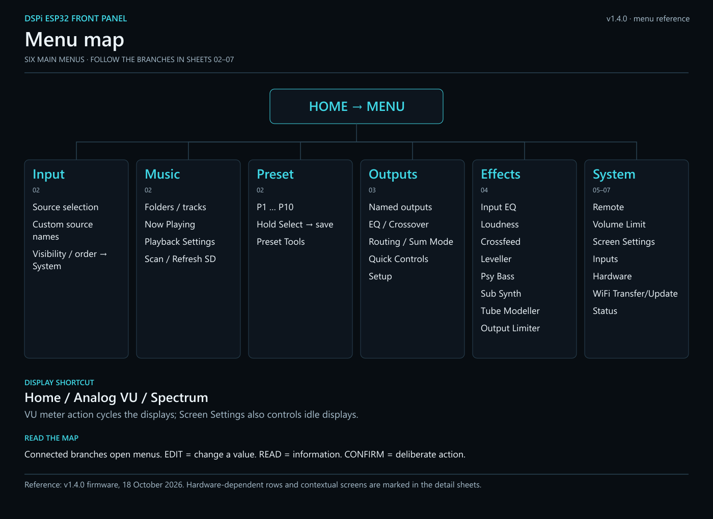
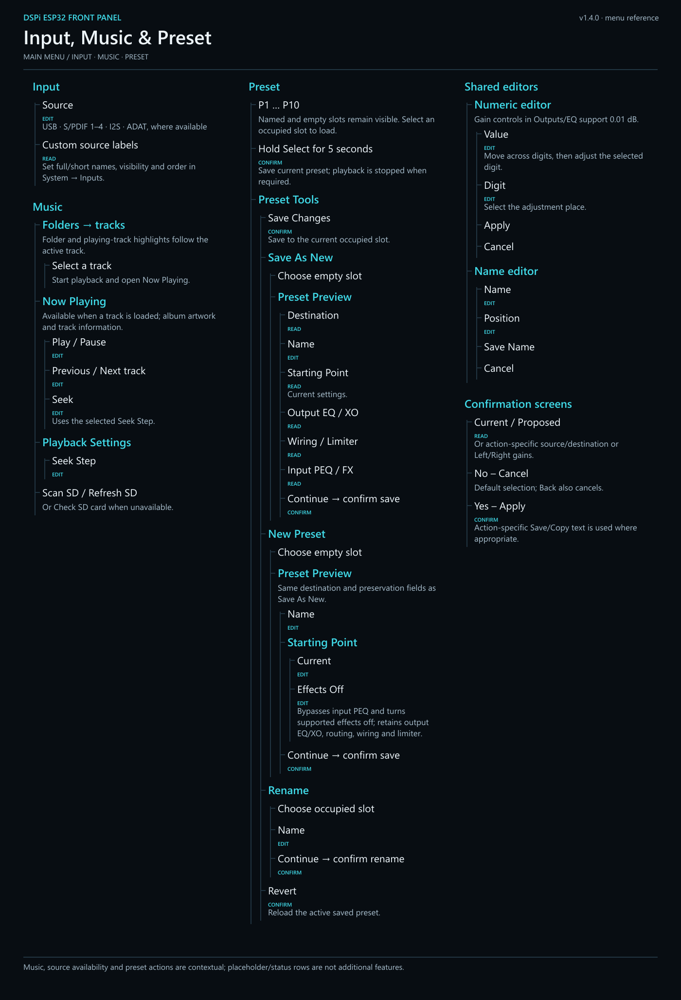
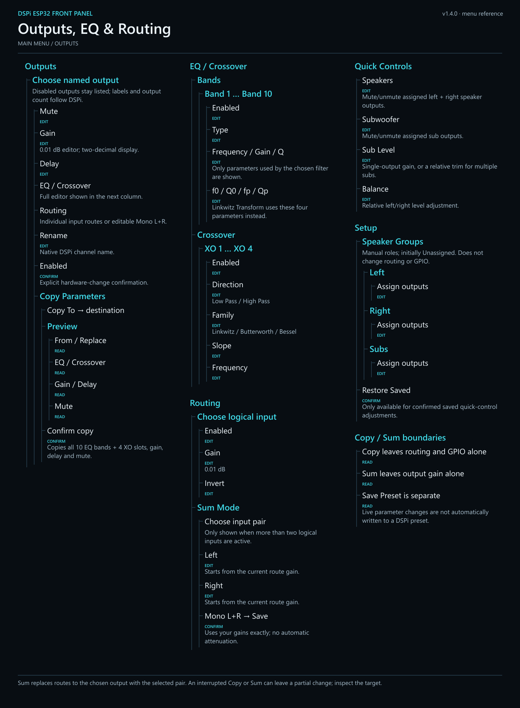
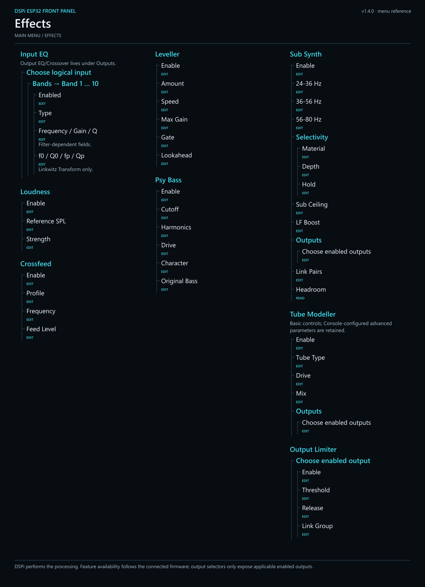
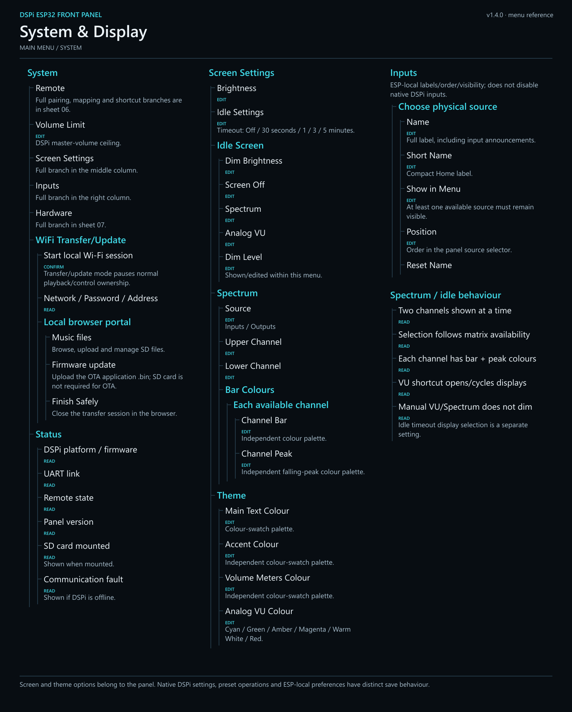
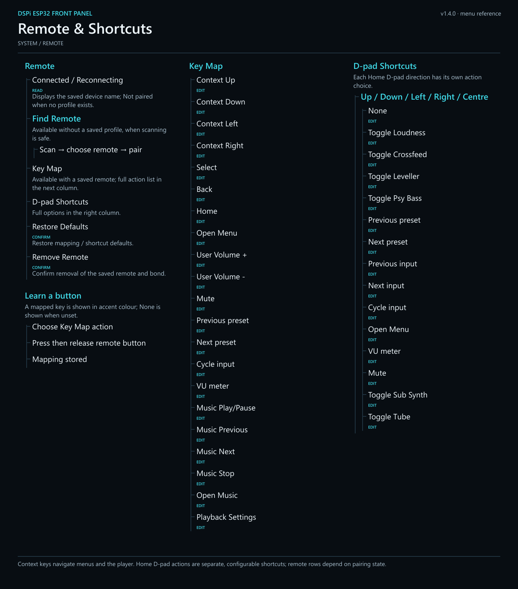
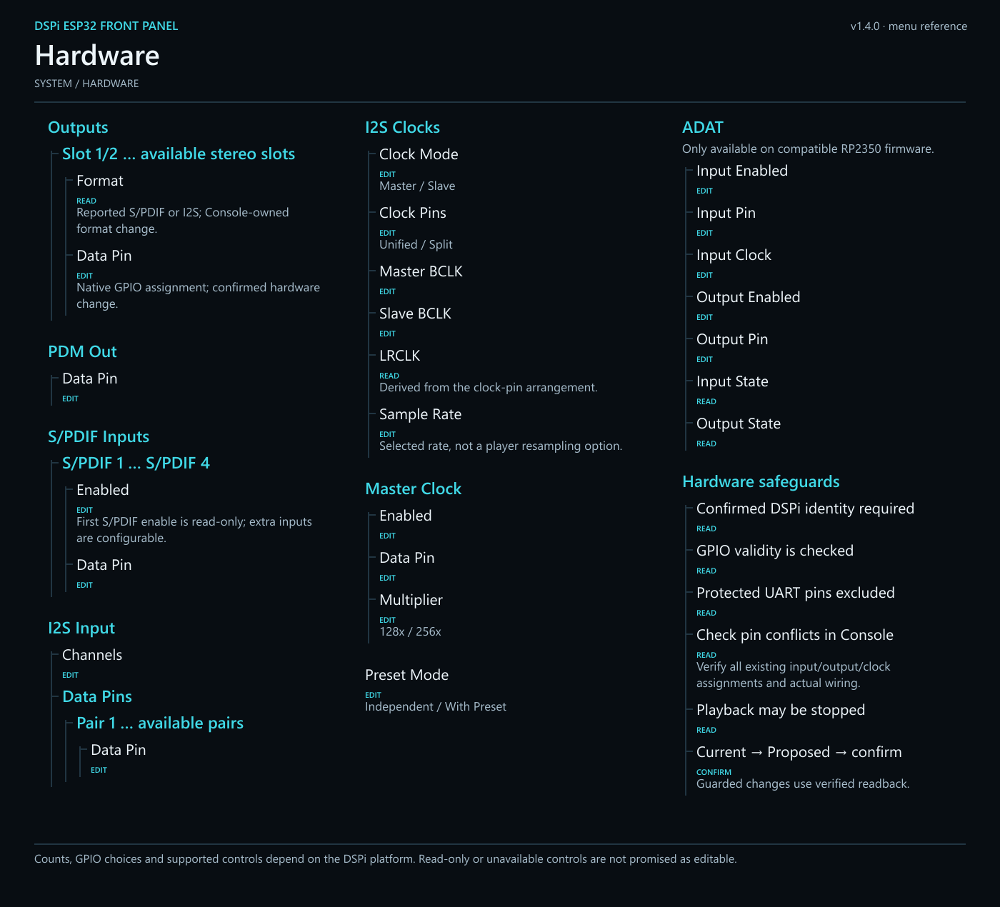

# DSPi ESP32 Front Panel — graphical menu reference

A black/white/cyan navigation reference for **v1.4.0**, dated 18 October 2026.

## Files

- **01-overview.png / .svg** — the six main menus and display shortcut.
- **00-complete-menu-map.png / .svg** — every sheet combined into a full-resolution poster. Open or download to zoom.
- **02-input-music-presets** — source selection, SD player, presets and shared editors.
- **03-outputs** — channel controls, EQ/crossover, routing/summing, quick controls and speaker groups.
- **04-effects** — Input EQ and all seven processing-effect menus.
- **05-system-display** — System, display/theme/spectrum settings, input aliases, local Wi-Fi and status.
- **06-remote** — pairing, all 21 key-map actions and all 15 Home D-pad choices.
- **07-hardware** — native DSPi input/output/clock/pin settings and read-only information.
- **MENU-REFERENCE.md** — accessible text counterpart to the detailed maps.
- **GITHUB-EMBED.md** — ready-to-copy README markup.

PNG is best for predictable GitHub display. SVG keeps the text scalable for zooming and future editing. Detail sheets are 1,400 pixels wide; the complete poster is 2,860 pixels wide. The overview is intentionally concise; the detailed sheets carry the full branches.

## Reading the map

Connected branches open menus. **EDIT** indicates an editable value, **READ** information, and **CONFIRM** an explicit action. Explanatory headings such as “Shared editors” and “Hardware safeguards” describe behavior rather than adding menus to the device.

Counts, source/output names, feature support and some rows vary with DSPi firmware, platform, enabled outputs, active input count, pairing state, SD state and preset contents. Such conditions are noted. Enum/colour choices are summarized where listing every selectable value would obscure navigation.

The editable Sum screen loads the current Left/Right route gains and applies the chosen gains without automatic attenuation. Copy Parameters includes all 10 EQ bands and four crossover slots. Speaker Groups remain manually assigned. These controls are included in v1.4.0.

## Browse the map

[Complete scalable poster](00-complete-menu-map.svg) · [Full-size PNG](00-complete-menu-map.png) · [Text reference](MENU-REFERENCE.md)

Input, Music and Preset

[Scalable SVG](02-input-music-presets.svg)

Outputs, EQ, crossover and routing

[Scalable SVG](03-outputs.svg)

Effects

[Scalable SVG](04-effects.svg)

System and display

[Scalable SVG](05-system-display.svg)

Remote and shortcuts

[Scalable SVG](06-remote.svg)

Hardware

[Scalable SVG](07-hardware.svg)

